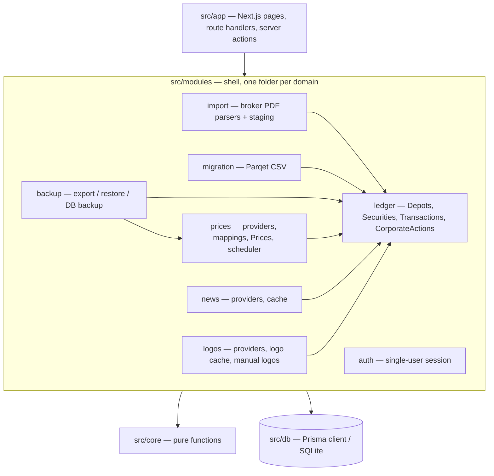
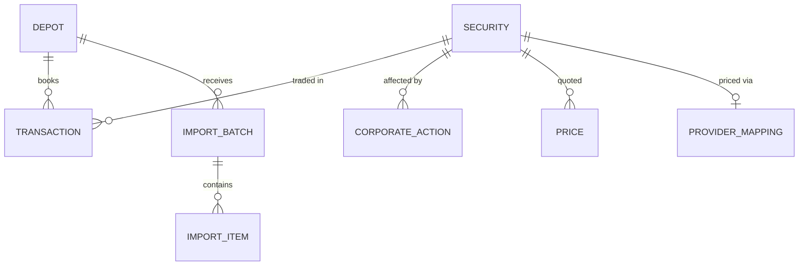
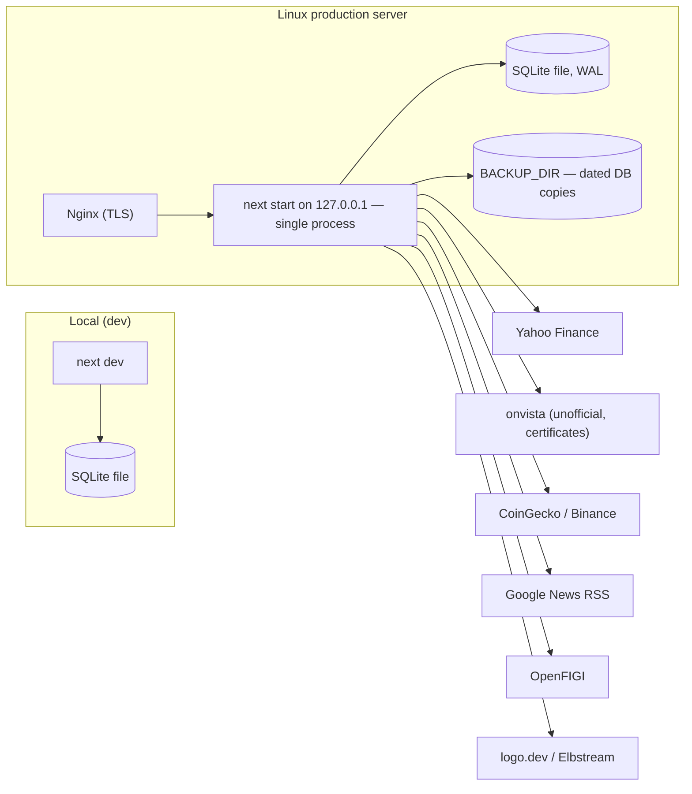

# Architecture Spine — DepotManagement

## Design Paradigm

**Functional Core, Imperative Shell**, packaged as a **modular monolith** in one Next.js app.

- **Ledger = the only truth.** Depots, Securities, Transactions, CorporateActions, ProviderMappings and Prices are stored. Nothing derived is.
- **Core (`src/core/`)** — pure TypeScript functions: FIFO lots, Positions, Cost Basis, Cash Account, split adjustment, price resolution, staleness, valuation series, TTWROR, XIRR, composition, duplicate matching, held Securities. No I/O, no Prisma, no clock; inputs in, results out.
- **Shell (`src/modules/`, `src/app/`)** — loads data, calls core, persists, renders; talks to SQLite, providers and uploaded files. Shell never computes financial results itself.



## Invariants & Rules

### AD-1 — Ledger is the single source of truth; everything else is derived `[ADOPTED]`

- **Binds:** all; FR-2, FR-10..FR-13, FR-16..FR-18
- **Prevents:** import, manual entry or restore mutating holdings or balances by different paths; numbers that disagree between screens.
- **Rule:** Positions, FIFO lots, Cost Basis, Cash Account balances, transaction-derived prices, values, returns and composition are never stored as authoritative data; `src/core` computes them from the ledger on read. Transactions may be added, edited and deleted (FR-2); every change is visible on the next read. A persisted snapshot is allowed only as a disposable cache: deleting every cache table must produce identical results. Quantities and balances are never edited directly — a correction is a Transaction.

### AD-2 — Dependency direction and model ownership `[ADOPTED]`

- **Binds:** all
- **Prevents:** financial logic leaking into routes or modules; modules coupling via each other's tables.
- **Rule:** `app → modules → core`, `modules → db`. `src/core` imports nothing from the project except its own files and `decimal.js`. A module reads or writes only the Prisma models it owns and reaches another module only through that module's exported service functions (`src/modules/<name>/index.ts`). Every writing service accepts an optional Prisma transaction client so callers can compose one DB transaction across modules. Ownership: `ledger` — Depot, Security, Transaction, CorporateAction; `prices` — ProviderMapping, Price; `import` — ImportBatch, ImportItem; `news` — news cache; `logos` — SecurityLogo and logo files; `auth` — session.

### AD-3 — One write path into the ledger `[ADOPTED]`

- **Binds:** FR-2, FR-3, FR-5, FR-6, FR-15, FR-16
- **Prevents:** validation, sequencing and duplicate handling implemented differently per entry path.
- **Rule:** Only the `ledger` module writes ledger rows. Manual entry, import confirmation and Parqet migration call the same ledger service, which validates (zod) against AD-14, assigns the intra-day sequence (AD-8) and runs the AD-15 duplicate match with the policy of its path. Restore is the one exception: `ledger.replaceAll` (and `prices.replaceAll`) validate the schema but skip duplicate matching and keep IDs and sequence numbers (AD-12).

### AD-4 — Import stages, never books `[ADOPTED]`

- **Binds:** FR-4, FR-5, FR-6, FR-15
- **Prevents:** half-reviewed documents or new Securities ending up in the ledger; parsers coupled to the DB.
- **Rule:** Uploads create an ImportBatch with one ImportItem per file (status `parsed | duplicate | failed` + reason) holding proposed Transactions in AD-14 shape. Nothing — not even a Security — is written to the ledger until the user confirms; confirmation revalidates each proposal against the current ledger and goes through AD-3. Each broker parser is a pure function `(extractedText) → TransactionProposal[] | ParseError`, registered per Broker and document type, tested against anonymised real text fixtures. The file hash only warns about a re-upload; it never blocks. Uploaded PDFs are discarded after the batch is confirmed or discarded.

### AD-5 — Money, quantities and prices are exact decimals end to end `[ADOPTED]`

- **Binds:** all numeric data; FR-2, FR-6, FR-10..FR-12, FR-15
- **Prevents:** float drift between storage, parser, FIFO and duplicate matching.
- **Rule:** Stored as `TEXT` columns holding canonical decimal strings (SQLite stores Prisma `Decimal` as REAL, so it is not used). Computed only with `decimal.js` in core; serialised with `toFixed()`. No SQL arithmetic, aggregation or numeric comparison on these columns. JS `number` is never used for money, quantity or price — only for return percentages and chart payloads at the presentation edge. Quantities up to 8 decimals. Booked amounts are stored exactly as the broker states them; core does not round intermediate results; rounding happens only at presentation. Correctness target: Depot value and Cost Basis exact; cent-level differences in realized Gain/Loss summed across many FIFO lots are acceptable.

### AD-6 — Cash side of a Transaction is derived `[ADOPTED]`

- **Binds:** FR-2, FR-15, FR-17, FR-18
- **Prevents:** a trade and its cash movement diverging or being edited separately.
- **Rule:** The Cash Account is identified by its Depot (1:1, no own table). A Parqet export without any `Cash` rows gets minimal funding: before any migrated row whose cash effect would take the running balance below zero, the migration inserts a same-day DEPOSIT for exactly the shortfall (one pure core function). Every Transaction is one row; `core/cash` derives its cash booking with one fixed formula per type (AD-14). Only Deposit and Withdrawal exist as cash-only Transactions. Parqet trade + cash pairs are collapsed into one row by migration; where the pair differs by rounding (≤ €0.01), migration adjusts `amount` so the derived cash booking equals the Parqet cash row. Trades and cash rows sharing one instant are reconciled as a group; a larger group difference is booked as one standalone TAX Transaction on that date, never by changing quantity, amount or fee, so Cost Basis matches Parqet and the Cash Account follows Parqet's cash rows. A migrated SELL exceeding the holding by ≤ 0.001 units is clamped to the holding and the shortfall is subtracted from the next BUY of that Security.

### AD-7 — Corporate actions are Security-scoped events; history is never rewritten `[ADOPTED]`

- **Binds:** FR-3, FR-8, FR-11, FR-12, FR-15
- **Prevents:** split-adjusted and unadjusted data mixed; FIFO dates lost on ISIN change; a split applied in one Depot but not another.
- **Rule:** Splits and ISIN changes are stored as CorporateAction rows on the Security and apply in every Depot holding it; Transactions and Prices before them are never modified. Split adjustment of quantities and Prices is applied by core on read, on top of unadjusted stored Prices (AD-9). An ISIN change links old and new Security (each its own row) with old/new quantity; core moves open FIFO lots, their original purchase dates and total Cost Basis to the new Security. Parqet Security transfers at one timestamp are paired by ISIN first (same ISIN → split CorporateAction), then a single out/in of different ISINs → ISIN-change CorporateAction; an unpaired TransferIn is migrated as a delivery (BUY at Parqet cost plus same-day DEPOSIT of equal amount, AD-14); only an unpaired TransferOut is flagged. CorporateActions are created, edited and deleted only through `ledger`.

### AD-8 — Dates and ordering `[ADOPTED]`

- **Binds:** all ledger data; FR-3, FR-6, FR-8, FR-12
- **Prevents:** timezone shifts moving a booking to another day; non-deterministic FIFO order on same-day trades.
- **Rule:** Transactions, CorporateActions and Prices carry a business date `YYYY-MM-DD` (Europe/Berlin), not a timestamp. Transactions within one Depot and date carry an integer sequence assigned only by the ledger service (appended after the last of that date; migration submits rows oldest-first). FIFO and all evaluations order by `(date, sequence)`; on the same date corporate actions apply before Transactions. Parqet's synthetic times are dropped. Core receives "today" as a parameter.

### AD-9 — Price providers, storage basis and precedence `[ADOPTED]`

- **Binds:** FR-7, FR-8, FR-9, FR-11, FR-12
- **Prevents:** prices from different listings mixed; double split adjustment; chart and overview using different prices for the same day; scheduler overwriting manual prices.
- **Rule:** Every price source is a provider behind one interface (`fetchLatest`, `fetchHistory` by provider symbol, returning EUR closes per date). Each Security has at most one active ProviderMapping (provider + symbol), auto-resolved once (OpenFIGI / Yahoo search by ISIN) and editable by the user. No automatic failover between providers. Stored Prices are always **unadjusted, as-traded closes**; an adapter whose provider returns adjusted history undoes the adjustment using CorporateActions and is contract-tested against a Security with a known split; recording a split triggers a history refetch for that Security. Price rows: `source ∈ {manual, provider}`, unique `(securityId, date, source)`, with a UTC `fetchedAt`. Manual Prices are written through `prices`. One core resolver decides the Price on a date: **manual > provider > price of a Transaction on that date (derived on read, never stored)**, else the last known Price carried forward. One core `isStale(latestPriceDate, today)` (older than 3 calendar days) drives every stale flag. `prices` backfills history from the first Transaction date for every held Security (AD-17) on the scheduler run and after a ledger write introduces a new held Security.

### AD-10 — Performance boundary and cash flows `[ADOPTED]`

- **Binds:** FR-10, FR-11, FR-12, FR-18
- **Prevents:** TTWROR and XIRR, or Portfolio and Depot figures, using different notions of an external flow or of invested capital.
- **Rule:** The unit of measurement is a Depot including its Cash Account; the Portfolio is the sum of non-archived Depots. Both return metrics and all Period figures come from one daily valuation series produced by core. External cash flows are Deposits, Withdrawals and net taxes (paid minus refunds) — the tax cash debit is classified as external, not counted twice — so returns and Gain/Loss are gross, with taxes shown separately. Period Gain/Loss = change in value − net external flows, split into realized, unrealized, dividends and fees. Invested capital = FIFO Cost Basis of open Positions, computed by one core function used by every view.

### AD-11 — News providers are swappable and outside the ledger `[ADOPTED]`

- **Binds:** FR-14
- **Prevents:** news concerns bleeding into ledger or backup; per-screen news fetching.
- **Rule:** News providers follow the AD-9 provider pattern and query by company name or ticker (not ISIN) for the held Securities of AD-17. Initial set: Google News RSS (de + en) primary, `yahoo-finance2` search news secondary. Headlines are cached by `news`, are not ledger data, are not backed up, and link to the original article.

### AD-12 — Backup and restore `[ADOPTED]`

- **Binds:** FR-16
- **Prevents:** a restore that depends on vanished price sources; partial or merged restores; old exports becoming unreadable.
- **Rule:** Export is one JSON file with a `schemaVersion`, containing Depots, Securities, ProviderMappings, Transactions, CorporateActions, all stored Prices and manually uploaded logos (base64). Caches, staging, news and fetched logos are excluded. Restore validates the file, upgrades older `schemaVersion`s through pure upgrade functions, takes an automatic export of the current data, then in one DB transaction clears staging and caches and calls `ledger.replaceAll` and `prices.replaceAll`. It never merges.

### AD-13 — Single instance, single user, nothing leaves except symbols `[ADOPTED]`

- **Binds:** NFR deployment, privacy, public repository
- **Prevents:** duplicate scheduler runs; unprotected network exposure; secrets or financial data leaving the server.
- **Rule:** The app runs as exactly one Node process. The scheduler lives in that process (Next.js `instrumentation.ts`, guarded against double start): price fetch on start and daily, plus on demand; daily DB backup (AD-18). Access requires the in-app single-user login (password hash + signed session cookie) on every page and route except login. Next.js telemetry is disabled and no analytics are embedded. Outbound requests carry only provider symbols, ISINs or company names — never quantities, values or Depot data.

### AD-14 — Canonical Transaction shape

- **Binds:** FR-2, FR-4, FR-5, FR-6, FR-12, FR-15, FR-17
- **Prevents:** parsers, migration, manual form and `core/cash` storing or reading amounts with different meanings (gross vs net, sign, included fees).
- **Rule:** Types: `BUY`, `SELL`, `DIVIDEND`, `FEE`, `TAX`, `DEPOSIT`, `WITHDRAWAL`. `amount` is the unsigned gross value of the event, never including fee or tax (for a dividend: gross total, not per share). `fee ≥ 0`. `tax` is signed: positive = paid, negative = refund. Direction comes only from `type`. `quantity` and `price` are set only on `BUY` and `SELL`. Standalone `FEE` and `TAX` carry their value in `fee` / `tax` with `amount = 0`. `securityId` is required for `BUY`, `SELL`, `DIVIDEND`, optional for `FEE`/`TAX`, absent for `DEPOSIT`/`WITHDRAWAL`. Cash effect, defined once in `core/cash`: `BUY −(amount+fee+tax)`, `SELL / DIVIDEND +amount−fee−tax`, `FEE −fee`, `TAX −tax`, `DEPOSIT +amount`, `WITHDRAWAL −amount`. Every writer normalises to this shape before calling `ledger`.

### AD-15 — Duplicate matching is one advisory function

- **Binds:** FR-5, FR-6, FR-15
- **Prevents:** the same dividend or trade not recognised across import and migration; legitimate identical savings-plan buys dropped.
- **Rule:** `core/duplicates` alone decides, on AD-14-shaped data, with key `(depotId, date, type, securityId | null, quantity | null, amount within €0.01)`; an incoming ISIN is first resolved to its current Security by following ISIN-change CorporateActions. The result is `unique | duplicate | ambiguous` and never drops anything by itself. Policy per path: import and migration show duplicates and ambiguous matches in review (migration matches against the existing ledger only, not within its own file); manual entry warns and asks for confirmation; restore skips matching.

### AD-16 — Securities have one creator and one owner

- **Binds:** FR-2, FR-4, FR-13, FR-15
- **Prevents:** the same instrument created twice from different paths; asset types guessed differently per path.
- **Rule:** Securities are created only by idempotent `ledger.ensureSecurity({ isin } | { cryptoSymbol })`, called at confirmation or save, never during staging. ISIN and upper-case base crypto symbol (e.g. `BTC`) are each unique. Only `ledger` writes name and `assetType` (`STOCK | ETF | FUND | CERTIFICATE | CRYPTO | UNCLASSIFIED`); other modules may suggest values. The Parqet migration estimates the type with one pure core classifier (name rules; default STOCK) and never blocks on it; the type stays editable through `ledger`. `UNCLASSIFIED` remains only for Securities no path could classify.

### AD-17 — Archived Depots and the held set

- **Binds:** FR-1, FR-7, FR-10, FR-13, FR-14
- **Prevents:** Transactions booked into an archived Depot silently vanishing from totals; prices, news and composition disagreeing on what is held.
- **Rule:** Archiving is refused while the Depot has open Positions or a non-zero Cash Account balance. An archived Depot is read-only — the ledger rejects writes until it is unarchived — and is excluded from every aggregate but stays viewable. One core function `heldSecurities(ledger)` (open Positions in non-archived Depots) is the only definition of "held" for prices, news and overviews.

### AD-18 — Operational envelope `[ADOPTED]`

- **Binds:** NFR deployment, public repository, FR-16
- **Prevents:** config drift between modules; schema changes applied at random times; corrupt DB copies.
- **Rule:** All configuration comes from environment variables / an untracked `.env` with fixed names: `DATABASE_URL`, `SESSION_SECRET`, `AUTH_USERNAME`, `AUTH_PASSWORD_HASH`, `BACKUP_DIR`, `BACKUP_KEEP`, `COINGECKO_API_KEY`, `OPENFIGI_API_KEY`, `LOGO_DEV_API_KEY`, `DATA_DIR` (logo files); `.env.example` lists them without values. The SQLite file and backups live outside the source tree. SQLite runs in WAL mode with a busy timeout. `prisma migrate deploy` runs in the deploy/start script before the app starts; the app never migrates itself; committed migrations are immutable. The daily DB backup uses better-sqlite3 `backup()` to dated files in `BACKUP_DIR`, keeping `BACKUP_KEEP`. Moving data between local and production uses JSON export/restore (AD-12).

### AD-19 — Security logos are fetched once, served locally

- **Binds:** UX Security logo (every Security mention), FR-2, FR-13, FR-14
- **Prevents:** the browser hotlinking third-party logo services (privacy, AD-13); each screen fetching or falling back differently; fetched logos overwriting a manual one.
- **Rule:** The `logos` module owns logo resolution and storage. Logo providers follow the AD-9 provider pattern, queried by ISIN, ticker or crypto symbol only: logo.dev (secret-key API) primary, Elbstream fallback; certificates resolve to the issuer or underlying logo, else none; crypto falls back to the CoinGecko image. A logo is fetched once in the background when a Security is created or first held, stored as a file under `DATA_DIR` with source and `fetchedAt`, and served by the app from its own route — the browser never calls a logo provider. A manually uploaded logo (`source = manual`) always wins and is never overwritten. Missing logo → the UI renders initials; a logo fetch never blocks a ledger write.

## Consistency Conventions

| Concern | Convention |
| --- | --- |
| Naming | PRD glossary terms are the code names: `Depot`, `Broker`, `Security`, `Position`, `Transaction`, `CashAccount`, `Price`, `CorporateAction`. Code and identifiers in English. Broker is an enum on Depot (`COMDIRECT`, `DEUTSCHE_BANK`, `FINANZEN_ZERO`). |
| IDs | Prisma `cuid()` string IDs. Securities are found by ISIN or crypto symbol, never by name. |
| Data formats | Dates `YYYY-MM-DD` strings; decimals as strings in DB, JSON API and backup. Currency is implicit EUR — no currency columns in v1; migration rejects non-EUR rows for review. |
| Validation & errors | zod schemas at every shell boundary (forms, route handlers, parser output, backup file). Expected failures return typed results (`{ ok: false, reason }`), not thrown exceptions; core throws only on programmer errors. |
| Mutations | Server actions / route handlers call module services; UI never touches Prisma. After a ledger write the affected routes revalidate. |
| UI | MUI components, responsive layouts that work at phone width; no separate mobile app or routes. |
| Logging | Server logs to stdout; never log amounts per Transaction, credentials or keys. |
| Tests | vitest. Core, parsers and provider adapters are unit-tested; migration is reconciled against Parqet's `realizedgains` and balances using local, untracked fixtures. No personal data in the repo. |

## Stack

| Name | Version |
| --- | --- |
| Node.js | 24 LTS (`engines: >=24.11 <25`) |
| TypeScript | 5.9.3 |
| Next.js (App Router) | 16.4.2 |
| React / React DOM | 19.3.0 |
| Prisma CLI, `@prisma/client`, `@prisma/adapter-better-sqlite3` (exact pins) | 7.10.1 |
| better-sqlite3 | 12.11.1 |
| MUI (`@mui/material`, `@mui/material-nextjs`) | 9.5.0 |
| Emotion (`@emotion/react`, `/styled`, `/cache`) | 11.14.x |
| zod | 4.6.7 |
| decimal.js | 10.6.0 |
| unpdf (PDF text extraction) | 1.9.1 |
| yahoo-finance2 | 4.0.5 |
| jose / bcrypt | 6.2.13 / 6.0.0 |
| vitest | 5.0.5 |

## Structural Seed

```text
src/
  app/            # Next.js routes, pages, server actions — thin
  core/           # pure: fifo, cash, corporate-actions, prices, valuation, returns, composition, duplicates, held
  modules/
    ledger/       # sole ledger writer; ensureSecurity; replaceAll
    import/       # staging + parsers/<broker>/<doc-type>.ts
    migration/    # Parqet CSV -> AD-14 proposals
    prices/       # providers/<name>.ts, mappings, manual prices, scheduler jobs
    news/         # providers/<name>.ts, cache
    logos/        # providers/<name>.ts, logo files under DATA_DIR, manual upload
    backup/       # JSON export/restore, schema upgrades, DB file backup
    auth/         # login, session
  db/             # Prisma client singleton (WAL, busy timeout)
  instrumentation.ts  # starts the in-process scheduler
prisma/           # schema.prisma, migrations/
test/fixtures/    # anonymised parser texts only; real exports stay untracked
```





## Capability → Architecture Map

| Capability / Area | Lives in | Governed by |
| --- | --- | --- |
| FR-1 Depots | `modules/ledger` | AD-1, AD-2, AD-17 |
| FR-2 Manual Transactions | `modules/ledger`, `app` | AD-3, AD-5, AD-8, AD-14, AD-15, AD-16 |
| FR-3 Corporate actions | `modules/ledger`, `core/corporate-actions` | AD-7, AD-8 |
| FR-4..FR-6 Document Import | `modules/import`, `core/duplicates` | AD-3, AD-4, AD-14, AD-15, AD-16 |
| FR-7..FR-9 Prices | `modules/prices`, `core/prices` | AD-9, AD-13, AD-17 |
| FR-10..FR-13 Overview, chart, Gain/Loss, composition | `core/valuation`, `core/returns`, `core/composition`, `app` | AD-1, AD-5, AD-9, AD-10, AD-17 |
| FR-14 News | `modules/news` | AD-11, AD-17 |
| UX Security logos | `modules/logos` | AD-13, AD-19 |
| FR-15 Parqet migration | `modules/migration` | AD-3, AD-6, AD-7, AD-8, AD-14, AD-15, AD-16 |
| FR-16 Export / restore | `modules/backup` | AD-3, AD-12 |
| FR-17, FR-18 Cash Account | `core/cash`, `modules/ledger` | AD-6, AD-10, AD-14 |
| NFR deployment, privacy, public repo | `modules/auth`, `modules/backup`, config | AD-13, AD-18 |

## Deferred

- **News fallback** — switch to Marketaux (free key) if Google News RSS quality or terms prove unsuitable while building FR-14; AD-11 makes it an adapter change.
- **Fallback provider for German ETFs if Yahoo breaks** — onvista adapter or paid EODHD (~€20/month), decided when an outage or coverage gap occurs; AD-9 makes it an adapter/mapping change.
- **Cash Account balance when a Parqet export has no cash rows** — decided in the migration story with a real comdirect/ROBIN export; AD-6 and AD-14 still govern the resulting rows.
- **Snapshot/caching tables** — added only if compute-on-read is measurably slow; bound by AD-1.
- **finanzen.net zero document parser, spin-offs, mergers with cash** — out of v1 (PRD); parser registry and CorporateAction type leave room.
- **UI component structure, chart library, page layout** — no cross-epic divergence risk beyond MUI and the UI convention; chosen in the first UI story.
- **Deployment automation (systemd unit, deploy script contents)** — decided in the deployment story; must respect AD-13 and AD-18.
- **Multi-currency, multi-user** — non-goals for v1.
